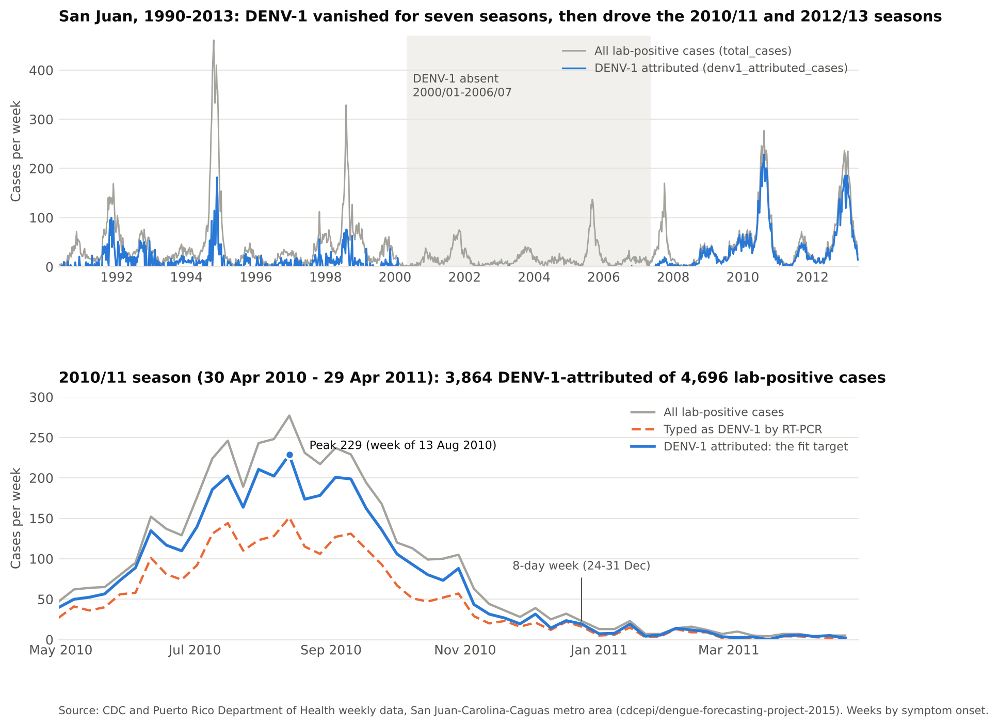

# AB package: data and literature

MATH 574 Team 2 · Stage 1, role AB · Version of 1 November 2026

This package covers the AB role in the Stage 1 plan. It has the raw case data with source notes, the data checks, a clean weekly dataset, a data dictionary, a case plot, a script that rebuilds everything, and a parameter table with units, sources and evidence gaps. It also covers the inputs the team was missing: evidence for s0, the reporting fraction and the size of intervention effects.



## One change from the plan

The plan says to take the San Juan data from the DengAI competition (Kaggle/DrivenData). DengAI's San Juan labels stop on 22 Apr 2008 and the 2010/11 weeks sit in its unlabelled test set, so it has no case counts for the calibration season and no serotypes. This package uses the CDC and Puerto Rico Department of Health files that DengAI was built from (`cdcepi/dengue-forecasting-project-2015`). They have every week from 1990 to 2013, by serotype. The plan's columns `week_start_date`, `weekofyear` and `total_cases` are kept.

## What's inside

| Path | What it is |
|---|---|
| `data/calibration_san_juan_2010_11.csv` | The fitting dataset: 52 weeks, 30 Apr 2010 to 29 Apr 2011, with the fit target `denv1_attributed_cases` (3,864 cases), real week boundaries and weekly `eps_v` |
| `data/secondary_san_juan_2012_13.csv` | The 2012/13 season for the cross-season check (4,091 DENV-1-attributed cases) |
| `data/san_juan_weekly_cases_1990_2013.csv` | All 23 seasons, 1,196 weeks |
| `data/temperature_san_juan_weekly_1990_2013.csv` | Weekly temperature, rainfall and extrinsic incubation period for every case week |
| `data/demography_puerto_rico_1990_2024.csv` | Metro and island population, life expectancy, birth and death rates, `d_h` |
| `data/age_structure_puerto_rico_2010.csv` | Age bands for 2010, used in the s0 evidence |
| `data/puerto_rico_weekly_opendengue.csv` | Island-wide weekly cases, 2014–2024 |
| `data/validation_puerto_rico_2024.csv` | The 52 weeks of 2024 (6,088 cases), for the qualitative comparison |
| `parameters/parameters.csv` | Every parameter: baseline, range, units, status, source, evidence gap |
| `parameters/parameters.json` | `PARAMS` with exactly the keys of `dengue_model.py`, plus ranges for the fitted and scenario parameters |
| `literature/evidence.md` | Sources for every value, the s0 evidence and recommendation, intervention effect sizes, evidence gaps |
| `data_dictionary.md` | Every column of every file |
| `checks/data_checks.md` | Results of the checks on dates, geography, case definition, missing and duplicate weeks, population and temperature |
| `checks/raw_manifest.csv` | SHA-256 checksum and source of every raw file |
| `figures/cases_san_juan.png` | Case plot: 1990–2013 and the 2010/11 season |
| `raw/` | Source files exactly as downloaded, with their metadata |
| `build_ab_package.py` | Rebuilds `data/`, `checks/`, `figures/` and `parameters.json` from `raw/` |

## For each role

- **D (Xindi):** `parameters/parameters.json` holds `PARAMS` with the 12 keys `dengue_model.py` uses, so it can replace the provisional dictionary directly:

  ```python
  import json
  PARAMS = json.load(open("parameters/parameters.json"))["PARAMS"]
  ```

  N_h becomes 2,347,833 (the metro area the case data cover) and d_h becomes 3.478e-5 (life expectancy 78.717 years in 2010). The other values match Table 1. For a temperature-driven `eps_v`, use `eps_v_per_day` from the calibration file.
- **E1 (Zaid):** fit `denv1_attributed_cases` in `data/calibration_san_juan_2010_11.csv`, with `days_since_start` as the week boundaries (week 35 is 8 days long). Fix s0 per scenario, and fit m in [1, 20] and φ in [0.003, 0.023] (`parameters.json`, `fitted_or_scenario`).
- **E2 (Fahad):** the calibration file holds the same series as file 02 of the Section 4 data package (3,864 cases). The 2012/13 and 2024 files are ready for the holdout and comparison steps.
- **C (Aileen):** every rate is per day. Units, ranges and sources are in `parameters.csv`.
- **F (Deckar):** intervention evidence is in `literature/evidence.md`, section 4. That covers compliance κ (about 0.45 in Ponce, 2018–19), per-bite efficacy η, screens, traps (about an 80% cut in mosquitoes in Puerto Rico) and spraying (no effect size from trials). Calibration keeps κ = η = 0, so scenarios are changes from 2010 behaviour.

## Decisions for the team

1. **s0:** use 0.4 as the central scenario, with 0.2 and 0.6 as alternatives. The evidence puts s0 at about 0.30–0.44 on 30 Apr 2010 (`literature/evidence.md`, section 3).
2. **m bounds:** raise the upper bound from 10 to 20, so every s0 down to 0.2 can be fitted. m × s0 is fixed at about 3.9.
3. **κ and η:** keep both at 0 in calibration, so that protection already in use in 2010 stays inside a0.
4. **φ:** treat it as a share of all infections, 0.003–0.023. The plan's p (0.035–0.09) is the share of symptomatic cases that get reported, which is only one factor of φ.

## Checks at a glance

All 1,196 weeks are present with no duplicates, missing values or negatives, and every week's total equals its parts. One week a year runs 8–9 days, always the one ending 31 December, so fits should use real dates. DENV-1 had at most one typed case a season from 2000/01 to 2006/07. The 2024 weekly series has all 52 weeks, and they sum to OpenDengue's annual figure of 6,088. Full results are in `checks/data_checks.md`.

## Rebuild

```bash
python build_ab_package.py
```

This needs Python 3.10+, numpy, pandas and matplotlib, and takes a few seconds. It never changes `raw/`.

## Sources

- **Dengue cases, population and weather:** CDC/PRDH dengue forecasting data, https://github.com/cdcepi/dengue-forecasting-project-2015 (commit 6ab36c9, CC BY 4.0). Johansson MA et al., PNAS 116(48):24268–24274, 2019. Weather comes from NOAA GHCN-Daily station RQW00011641.
- **Puerto Rico weekly cases:** OpenDengue V1.3, PAHO temporal and national extracts, https://github.com/OpenDengue/master-repo (commit f2232b8). Clarke J et al., Sci Data 11:296, 2024. `raw/opendengue/` keeps the rows where `adm_0_name` is PUERTO RICO.
- **Demography:** PAHO Core Indicators 2026 (release of 13 April 2026), https://opendata.paho.org/en/core-indicators. `raw/paho/` keeps Puerto Rico's rows for indicators 74, 275, 356–363, 414 and 415.
- **Literature:** listed with DOIs in `literature/evidence.md`.
